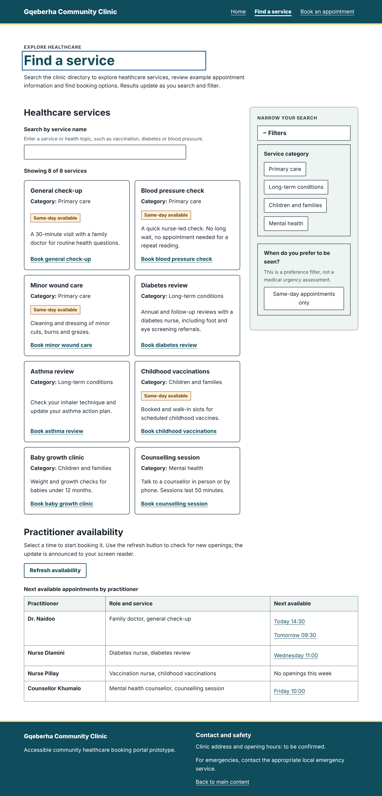
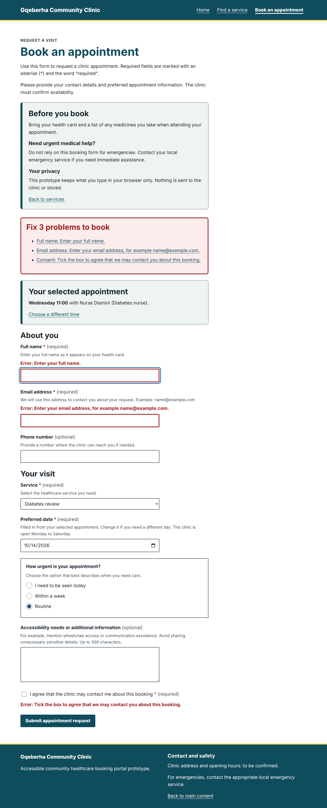
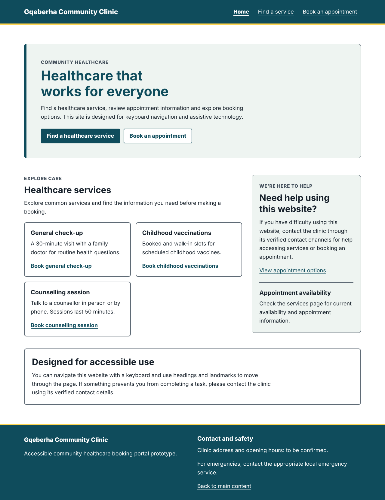

# Gqeberha Community Clinic: Accessible Healthcare Booking Portal

Capstone 4: Inclusive UI/UX and Accessible React Component Engineering. Domain: Community Healthcare Clinic.

A client-side React prototype that lets a blind keyboard-only NVDA user (the persona, Aisha Mbeki) find a service, filter the directory, pick an available appointment, complete a booking form, correct validation errors and receive a confirmation, with no mouse.

## Quick start

```bash
npm install
npm run dev        # http://localhost:5173
npm test           # 44 tests: unit, interaction, keyboard and axe-core accessibility audits
npm run build      # production build in /dist
```

## Repository layout

```
wireframes/     Part A: index.html, services.html, book.html, main.css, persona.md, wcag-matrix.md
src/            Part B: React app
  components/   Home, Services, Book, BookingForm, Field, Modal
  context/      AnnouncerContext (the live regions)
  styles.css    wireframes/main.css plus the rules only the app needs
  test/         Vitest, Testing Library, jest-axe
public/         screenshots
lighthouse/     Each page's lighthouse accesibility report
README.md       Part C (below)
```

## Screenshots

| Services directory | Booking form with errors | Home |
|---|---|---|
|  |  |  |

---

# Part C: Architectural and Accessibility Decisions

## 1. Accessibility trade-off analysis

**Native controls versus custom widgets.** Aisha's pain points include calendars she cannot operate with a keyboard. I therefore used a native `<input type="date">`, a native `<select>`, and plain links in a table for appointment times, instead of a custom calendar grid or listbox. A custom widget looks more uniform but must re-implement roles, arrow-key behaviour and mobile pickers, and each of those is a chance to break for NVDA. The cost is less control over how the date picker looks between browsers. Toggle chips are real buttons whose pressed state is shown by a check mark and a fill, never by colour alone.

**Modal focus trap versus free keyboard flow.** The booking confirmation is a dialog. Trapping Tab inside it, with `inert` on the page behind, stops keyboard and screen reader users wandering into page content that the dialog is covering. A trap risks WCAG 2.1.2, so it has three exits: Escape, a visible Close button, and focus returning to the control that opened it. I accepted a little less tabbing freedom to avoid losing the user's place.

**Live-region verbosity versus silence.** Announcing every keystroke would make the search unusable at Aisha's speech rate. Result counts are debounced by 500 ms and announced once, politely. Field errors are announced on blur, only for fields the user has edited, because focus has already moved on and they would not hear them otherwise. An error that is fixed clears silently. Only one message is assertive: "Booking not sent. N problems found." The cost is that some changes are visual-only, which is acceptable because each field's `aria-invalid` and description stay accurate.

## 2. How React state drives accessibility

React state is the single source of truth and ARIA attributes are derived in render, so they cannot drift from what is on screen:

- **State to attributes:** `aria-expanded={filtersOpen}` on the accordion, `aria-pressed` on each chip from the `categories` array, `aria-busy={loading}` on the availability region, and `aria-invalid` plus an error id inside `aria-describedby` from the `errors` object. `Field` builds `htmlFor`, hint and error ids in one place, so every input is wired the same way.
- **Live regions:** `AnnouncerProvider` renders two permanent, visually hidden regions once at the root (`role="status"` polite, `role="alert"` assertive), because screen readers only announce changes to a region that already exists. Any component calls `announce(text, priority)`. The refresh button uses `aria-disabled`, not `disabled`, so it keeps focus while loading.
- **Focus with `useRef` and `useEffect`:** on a view change, `App` focuses the new `<h1>` (`tabIndex={-1}`) and updates `document.title`. After a failed submit, focus moves to the first invalid field in an effect that runs after the errors render, so NVDA reads the label and the new error together. `Modal` records the opener, focuses its heading, and restores focus on unmount.
- **Choosing an appointment:** each time is a link carrying the practitioner, service and slot in the URL. `BookingForm` reads them in an effect, shows the chosen appointment, and fills the date from the slot, so Aisha does not type the same information twice.
- **Routing detail:** a plain `href="#main"` would trigger the hash router, so the skip link and "Back to main content" focus `<main>` through a ref.

## 3. Testing evidence

### Automated results (reproducible)

| Check | Result |
|---|---|
| `npm test` | 6 files, **44 tests passed, 0 failed** |
| axe-core (jest-axe) on the 3 wireframes and the 3 React views | **0 violations** each |
| axe-core on the booking form in its error state and on the services directory | **0 violations** |
| Contrast ratios written in `main.css` | A test recomputes every documented ratio with the WCAG formula and checks each is correct and at least 4.5:1 (lowest text pair 7.40:1) |
| Responsive reflow | No horizontal scrolling at 320 px on any view. This check caught a real bug (hidden text in the availability links widened the page), now fixed |

### Lighthouse accessibility audit

Lighthouse 13.4.1, Accessibility category, run against the production build (`npm run build && npm run preview`) in headless Chromium on 12 October 2026. The full reports are saved in `lighthouse/`.

| Page | Accessibility score | Report |
|---|---|---|
| Home | **100** | `lighthouse/home.html` |
| Find a service | **100** | `lighthouse/services.html` |
| Book an appointment | **100** | `lighthouse/book.html` |

### Manual NVDA 

| # | Task | Expected | Pass? |
|---|---|---|---|
| 1 | Load Home, press D to move between landmarks | banner, navigation "Main navigation", main, complementary, content information |Yes |
| 2 | Press Tab once, then Enter on the skip link | Focus moves to main content |Yes |
| 3 | Activate "Find a service" | The title changes and "Find a service, heading level 1" is read |Yes |
| 4 | Type "vacc" in the search, then stop | One announcement: "1 service found." |Yes |
| 5 | Press Space on a category chip | "Mental health, toggle button, pressed" |Yes |
| 6 | Press Enter on the Filters button twice | "collapsed", then "expanded" |Yes |
| 7 | Activate "Refresh availability" | The button reads as busy, then "Availability updated..." |Yes |
| 8 | Press Enter on the "Wednesday 11:00" time | The booking page opens; the service and date are already filled in |Yes |
| 9 | Press Enter on the empty form | "Booking not sent. 3 problems found." and focus lands on Full name with its error read |Yes |
| 10 | Fix the fields and submit | The dialog "Appointment requested" is read; Escape closes it; focus returns to the button |Yes |

### Manual keyboard tab sequence

- [x] **Home:** Skip link, brand, 3 navigation links, 2 hero buttons, 3 service links, "View appointment options", and "Back to main content".
- [x] **Services:** Skip link, navigation, search, "Clear search and filters" (when shown), service links in order, Filters button, 4 category chips, same-day chip, Refresh availability, availability region, time links, and "Back to main content".
- [x] **Book:** Skip link, navigation, "Back to services", "Choose a different time" (when shown), Full name, Email, Phone, Service, Date, urgency radios (one stop, arrow keys inside), Notes, Consent, and Submit.
- [x] **Keyboard accessibility:** No keyboard trap anywhere, and the focus ring is visible on every stop at 200% zoom.
